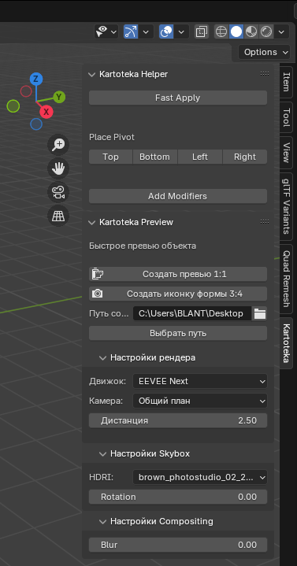

# Kartoteka Addon
Kartoteka Addon for Blender.

## Helper
- Fast Apply (All Transforms -> Unlink -> Merge By Distance) 
- Set pivot in 6 directions (Top, Bottom, Left, Right, Front, Back)
- Add 3 modifiers (Decimate Collapse [on], Decimate Planar [off], Weighted Normals [off])
- Create New Group

## Materials on the Objects
- Split by Materials — separate selected meshes into independent objects per material slot
- UV Scale 1m — auto-scale active UV map to the standard 1 m² texture tile reference (matches a default Blender cube face mapped 0..1)
- Rename for Tag — rename the single material of selected objects to a fixed tag (default `tag_wall-outside`); objects with 0 or ≥2 materials are skipped

## Preview
- Create a 1:1 preview
- Create a form icon
- Render settings
- Skybox settings
- Compositing settings

## Morph
- Stretching points by specified parameters and start sizes
