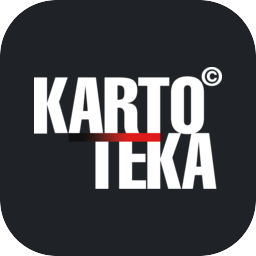

<div align="center">



# Kartoteka Addon

**Blender add-on for preparing Kartoteka catalog content** — clean up meshes, set pivots, split by
material, scale UVs to the 1 m² standard, render 1:1 previews and form icons, morph shapes — all
from one sidebar tab.


</div>

---

## Install

1. Download `kartoteka_addon.zip` (or zip the `kartoteka_addon/` folder).
2. Blender → **Edit › Preferences › Add-ons › Install…** → pick the zip → enable **Kartoteka Addon**.
3. The panels appear in the 3D Viewport sidebar (`N`) under the **Kartoteka** tab.

Blender **4.0+**; ships `bl_ext.json` for the 4.2 extension format as well.


## Panels

### Helper
- **Fast Apply** — All Transforms → Unlink → Merge By Distance in one click
- **Place Pivot** — snap the pivot to one of 6 sides (Top, Bottom, Left, Right, Front, Back)
- **Add Modifiers** — Decimate Collapse (on), Decimate Planar (off), Weighted Normals (off)
- **Create New Group**

### Materials on the Objects
- **Split by Materials** — separate selected meshes into independent objects per material slot
- **UV Scale 1 m** — scale the active UV map to the 1 m² texture-tile reference (a default Blender cube face mapped 0..1)
- **UV 1m World** — project UVs in world space at the same 1 m² reference: walls run horizontally along the wall and straight up, floors and roofs by X/Y, so bricks never end up sideways or upside down
- **Rename for Tag** — rename the single material of selected objects to a fixed tag (default `tag_wall-outside`); objects with 0 or ≥ 2 materials are skipped

### Preview
- **Create a 1:1 preview** and **Create a form icon (3:4)** — EEVEE Next render with a chosen camera framing and distance
- **Render / Skybox / Compositing settings** — HDRI, rotation, blur, output path

### Morph
- Stretch points by given parameters and start sizes (Full Width, Proportional, Direction)

### Custom Properties
- Edit Kartoteka custom properties on the selected object

## Layout

```
kartoteka_addon/
├── __init__.py            bl_info, registration
├── helper_panel.py        Helper panel
├── fast_apply.py place_pivot.py add_modifiers.py new_group.py
├── material_tools.py uv_scale.py
├── preview_panel.py render_utils.py camera_utils.py skybox_manager.py compositing_manager.py
├── morph.py
├── custom_properties.py
├── operators.py node_utils.py prefs.py
└── bl_ext.json            Blender 4.2 extension manifest
```
